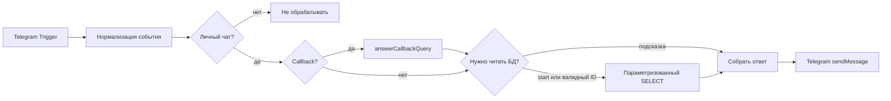

# Telegram-бот: динамическое меню LD LATTE

Бот для проверки: **@ZmeiiniyBot**. Workflow создан для установленного n8n **2.45.6**, импортирован на сервер и пока **выключен**. Токен Telegram и Postgres credential ещё не привязаны; живые ответы бота не проверены.

## Материалы

- [workflow.json](workflow.json) - импортируемый экспорт без значений секретов и без ссылок на чужие credentials.
- [SOURCE_SETUP.md](SOURCE_SETUP.md) - создание таблицы/роли в Supabase, пароль роли, pooler/TLS, тестовые наборы и права.
- [logic.mjs](logic.mjs) - чистая логика, встраиваемая в Code nodes.
- [build-workflow.mjs](build-workflow.mjs) - воспроизводимое построение экспорта.
- [tests/logic.test.mjs](tests/logic.test.mjs) - десять тестов, включая исполнение встроенного Code.

## Как работает



При каждом /start выполняется новый SELECT активных services. Число и названия кнопок определяются результатом, одна кнопка в строке. Callback содержит `svc:<UUID>` (40 ASCII-байт), не название. По нажатию услуга перечитывается: переименование возвращает текущее имя; отключение/удаление - предложение обновить /start.

SELECT агрегирует данные в одну строку JSON, поэтому отсутствие услуг не обрывает n8n-поток на zero items. Ошибка БД обрабатывается отдельно от пустого списка. Callback подтверждается до чтения БД. Неверный формат UUID не попадает в SQL, значения передаются через Query Parameters. Сервисная роль видит только active=true даже без фильтра SQL.

Динамическая клавиатура использует `inlineKeyboard.rows` как expression, а не фиксированные UI-строки. Telegram node по умолчанию включает Markdown; поэтому задан явный HTML parse mode, а название в тексте ответа экранируется. Кнопочные labels отправляются обычными строками. Это сохраняет &, <, > и другие символы в названиях. Никакой конкатенации сырого JSON или SQL с callback data нет.

## Запуск с чистого окружения

1. Создать тестового бота через официальный BotFather или использовать отдельного уже созданного бота. Получить токен; не помещать его в Git/чат.
2. Применить [миграцию services](../../supabase/migrations/202610300002_services.sql), задать отдельный пароль роли и применить [fixture-2](../../supabase/fixtures/services-2.sql) по SOURCE_SETUP.
3. Запустить n8n с постоянным volume и публичным HTTPS webhook URL; [наша инфраструктура](../../deploy/README.md). Публичный proxy должен пропускать `/webhook/*` и Telegram secret-token header; editor не требуется открывать в Интернет.
4. Войти в редактор администратора. Для нашего экземпляра доступен локальный SSH-туннель `http://localhost:5678` на компьютере владельца. Если туннель остановлен, запустить `ssh -N -L 5678:127.0.0.1:5678 USER@N8N_HOST`; секреты вводятся только в интерфейс.
5. Создать **Telegram API** credential с токеном бота, проверить подключение. Один и тот же credential выбрать в трёх узлах: `Telegram updates`, `Answer callback`, `Send reply`.
6. Создать **Postgres** credential для n8n_services_reader по SOURCE_SETUP. Проверить TLS-подключение; выбрать его в `Read active services`. Внутренняя SQLite-БД n8n не меняется.
7. Импортировать workflow.json через Import from file, если он ещё не импортирован. Найти `LD LATTE - dynamic service menu`; для текущего сервера импорт уже выполнен, повторно не создавать.
8. Сохранить и **Publish/Activate** workflow после настройки credentials. Проверить, что Telegram Trigger зарегистрировал именно production HTTPS URL. Тестовый webhook `/webhook-test/*` публично не открыт.
9. Отправить /start боту в личный чат, нажать кнопки, пройти проверку ниже.

Один токен Telegram имеет один webhook. Не включать параллельно test-trigger и production на том же боте: тестовый режим может заменить webhook. Для разработки предпочтителен второй бот. В установленном Telegram Trigger обнаружена передача `secret_token` при регистрации webhook; proxy сохраняет этот заголовок. Прямой webhook без правильного секрета не должен считаться Telegram-событием.

## Сценарий сдачи

| Шаг | Изменение источника | Что показать |
|---|---|---|
| 1 | services-2.sql | /start, две кнопки, нажатие обеих |
| 2 | services-5.sql | /start, пять кнопок |
| 3 | services-9.sql | /start, девять кнопок, нажатие разных ID |
| 4 | Добавить десятую по services-edit-examples | /start показывает новую кнопку, workflow не редактируется |
| 5 | Переименовать первую | новый /start показывает имя; старая кнопка отвечает текущим именем |
| 6 | Отключить первую | новый /start не показывает её; старая кнопка сообщает недоступность |
| 7 | Удалить только дополнительную десятую, применить services-0.sql | /start сообщает отсутствие услуг |
| 8 | Вернуть services-2.sql | бот снова отвечает с двумя услугами |

Fixtures меняют только девять известных UUID, не посторонние данные. Для демонстрации ровно 0/2/5/9 не должно быть других активных записей; cleanup десятой услуги выполняется отдельным явным примером. Видео не должно показывать токены, пароли, credential editor или приватные настройки сервера.

Дополнительно проверить недоступный источник, невалидный callback, перезапуск n8n и сохранность workflow/credentials. Ошибка источника не должна выдавать «услуг нет». Любая запись в таблицу через credential бота должна быть запрещена.

## Локальная проверка экспорта

Требуется Node.js 22+; внешние зависимости для этих тестов не нужны:

```sh
node automation/telegram/build-workflow.mjs
node --test automation/telegram/tests/logic.test.mjs
git diff -- automation/telegram/workflow.json
```

Ожидается 10 успешных тестов и отсутствие diff при повторной генерации без изменений. Проверяются 0/2/5/9, подсказки, private chat, UUID, актуальное имя, пустой/сломанный источник, размер callback и исполнение встроенного Code. Это не вызовы Telegram и не доказательство живого подключения Postgres.

## Фактический статус

- Логика: 10/10 локальных тестов прошли.
- SQL/роль/fixtures: локальная PostgreSQL/PGlite-проверка агентом прошла с automatic RLS on/off, в том числе без таблицы requests и с защитной ошибкой при опасных PUBLIC grants.
- Импорт: точный workflow с 10 узлами импортирован штатным CLI n8n 2.45.6, exit 0. Перед импортом n8n остановлен и сохранена закрытая копия volume; затем процесс запущен. Другие контейнеры не останавливались.
- Совместимость: дополнительный тест `tests/installed-node.mjs` выполнен внутри установленного контейнера. Настоящий Telegram node собрал тела sendMessage с 0/2/5/9 кнопками и HTML; HTTP helper был подменён, реальные запросы/токены не использовались. Тест не заменяет живое взаимодействие с Telegram.
- Активность: выключен, credentials не привязаны. Реальный /start/callback, подключение pooler/TLS и показ всех наборов ещё предстоят.

## Известные границы

Тестовое рассчитано на личный чат; группы, inline mode и Telegram business messages не поддерживаются. Фикстуры маленькие, пагинация сотен услуг не нужна. Повторная доставка Telegram update может дать повторный ответ; сквозной exactly-once не обещается. Автоматический повтор sendMessage после неопределённого ответа не включён. Удаление/отключение услуги между чтением БД и отправкой ответа остаётся обычным окном изменения источника; следующий callback/start перечитает данные.

Официальные основания: [Telegram Trigger](https://docs.n8n.io/integrations/builtin/trigger-nodes/n8n-nodes-base.telegramtrigger/), [Postgres node](https://docs.n8n.io/integrations/builtin/app-nodes/n8n-nodes-base.postgres/), [Telegram Bot API](https://core.telegram.org/bots/api). Формат узлов дополнительно сверялся с исходниками установленного n8n, без чтения credentials.
