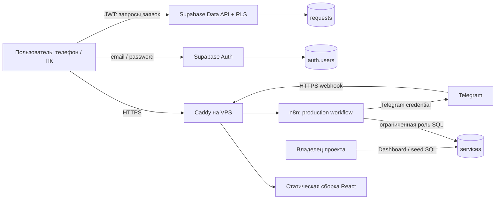
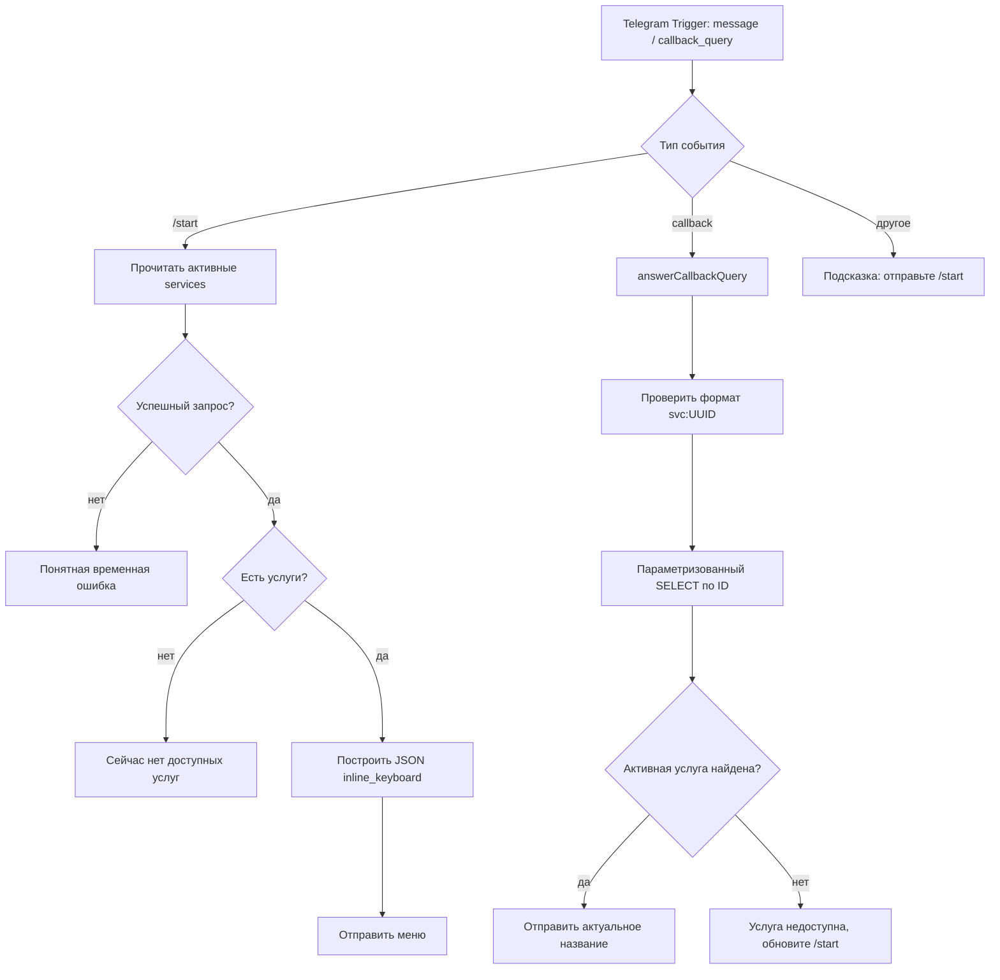

# Архитектура решения LD LATTE

Статус: проект решения, 29 октября 2026. Код приложения, workflow и размещение ещё не реализованы. Дедлайн: 31 октября, 17:00 Asia/Chita. Документ описывает выбранный вариант и отдельно отмечает решения, зависящие от доступов.

## 1. Объём и принципы

Три результата живут в одном репозитории, но могут запускаться и проверяться независимо. Веб-приложение отвечает за заявки; n8n - за Telegram; Instagram представлен исследованием. AI используется при разработке, но AI-функции внутри сервиса не требуются.

Не включаем в MVP админку, удаление заявок, вложения, уведомления, роли сотрудников и интеграцию Instagram в коде. Это оставляет время для проверки доступа, регистрации и реальной публикации.

Выбранный стек: React, TypeScript, Vite, supabase-js, обычный адаптивный CSS; Vitest для чистой логики, Playwright для ключевых пользовательских сценариев. Отдельный API-сервер не нужен. Версии пакетов фиксируем lockfile, контейнеров - проверенным тегом или digest при реализации.

## 2. Компоненты и границы доверия



Supabase размещён в облаке. На VPS только Caddy и n8n; VPN, DNS и мониторинг уже работают отдельно. Caddy раздаёт собранный frontend и проксирует webhook. Браузер обращается к Supabase непосредственно по HTTPS, а PostgreSQL применяет RLS независимо от интерфейса.

## 3. Организация исходников

```text
apps/web/
  src/app/                  инициализация, маршруты, auth state
  src/features/auth/        регистрация, вход, выход
  src/features/requests/    список, фильтры, формы, API
  src/shared/               Supabase client, UI, ошибки, CSS
  tests/                    браузерные сценарии
supabase/
  migrations/               requests, services, ограничения и политики
  fixtures/                 вымышленные услуги 0/2/5/9
  tests/                    проверки ограничений и изоляции
automation/telegram/
  workflow.json             импортируемый экспорт без credentials
  README.md                 настройка и демонстрация
deploy/
  compose.yaml              только новые сервисы проекта
  Caddyfile                 домены, TLS, маршруты
  .env.example              имена переменных, без значений секретов
docs/
  ARCHITECTURE.md
  IMPLEMENTATION_PLAN.md
  ACCEPTANCE.md
  instagram/                отдельный результат задачи 2
  ai-usage.md                фактический журнал разработки
```

Внутри frontend достаточно feature-модулей. Не вводим универсальные repository-абстракции и глобальное хранилище для нескольких экранов. API-функции изолируют Supabase от представления; типы БД генерируются из применённой схемы.

## 4. Данные приложения

### public.requests

| Поле | Тип / правило | Назначение |
|---|---|---|
| id | UUID, PK; генерируется один раз на создание | Идентификатор и защита от повторного INSERT |
| user_id | UUID NOT NULL, DEFAULT auth.uid(), FK auth.users(id) | Владелец заявки |
| title | text, trim, длина 1-160 | Название |
| description | text, trim, длина 1-10000 | Описание |
| category | text CHECK: bot / integration / report / other | Категория |
| status | text CHECK: new / in_progress / completed, DEFAULT new | Состояние |
| created_at | timestamptz, DEFAULT now() | Время создания |
| updated_at | timestamptz, DEFAULT now(), trigger при UPDATE | Время изменения |

Названия категорий и статусов в UI русские, значения в БД стабильные. Ограничения длины - наше проектное решение, а не требование PDF. Клиент выполняет те же проверки для быстрого ответа, БД остаётся последней проверкой. Время показываем в часовом поясе браузера, в БД храним timestamptz.

Индексы: (user_id, created_at DESC, id DESC) и при необходимости (user_id, status, created_at DESC). Для небольшого тестового поиск ILIKE по названию без отдельного поискового движка; символы %, _ и обратный слеш обрабатываем как буквальный ввод. Пагинация по 20 записей, поиск/фильтр сбрасывают страницу. Общее число и следующая страница относятся только к видимым пользователю данным.

created_at и user_id неизменяемы после создания; id также не меняется. Выдаём INSERT только на id, title, description, category; UPDATE только на title, description, category, status. Остальные значения при создании определяет БД. Все новые заявки получают new; передать status при пользовательском INSERT нельзя. Смена статуса разрешена при последующем UPDATE. После миграции проверяем, что широкие стандартные grants не сохранились.

### RLS и привилегии

RLS включается в той же миграции, что создаёт requests. У anon нет прав на заявки. У authenticated только SELECT, INSERT и UPDATE необходимых колонок, без DELETE. Удаление пользователя через административные средства вне приложения может каскадно удалять его заявки; в UI такой функции нет.

| Операция | Проверка |
|---|---|
| SELECT | роль authenticated, auth.uid() = user_id |
| INSERT | WITH CHECK: auth.uid() = user_id |
| UPDATE | USING и WITH CHECK: auth.uid() = user_id |
| DELETE | не предоставляем право и политику |

Пример намерения политики, не готовая миграция:

```sql
create policy requests_select_own on public.requests
for select to authenticated
using ((select auth.uid()) = user_id);

create policy requests_update_own on public.requests
for update to authenticated
using ((select auth.uid()) = user_id)
with check ((select auth.uid()) = user_id);
```

Привязка к auth.users использует первичный ключ. Дополнительная profiles-таблица не нужна. В браузер попадают только URL проекта и publishable/anon key; права определяются JWT и RLS. Секретный ключ, обходящий RLS, во frontend не используется. Основание: [Supabase RLS](https://supabase.com/docs/guides/database/postgres/row-level-security), [связь с auth.users](https://supabase.com/docs/guides/auth/managing-user-data).

## 5. Авторизация и интерфейс

Маршруты: /login, /register, /requests, /requests/new, /requests/:id, /auth/callback. При старте восстанавливаем сессию до показа защищённых экранов. При смене пользователя очищаем список и формы предыдущей сессии. Защита маршрутов отвечает за удобство; доступ к строкам контролируется БД.

Регистрация вызывает signUp, вход - signInWithPassword, выход - signOut. Успешный signUp без сессии означает ожидание подтверждения email, а не автоматический вход. Для callback задаём разрешённые локальные и опубликованные redirect URL. До реализации проверяем доставку писем и лимиты SMTP на двух тестовых адресах; не объявляем регистрацию рабочей по одному ответу API. Состояния подтверждения и ошибки описаны в [Supabase Password Auth](https://supabase.com/docs/guides/auth/passwords).

По умолчанию планируем подтверждение email с custom SMTP. Встроенный SMTP Supabase сейчас ограничен адресами участников команды и двумя письмами в час; для регистрации сторонних проверяющих на него не рассчитываем. Источник: [Supabase SMTP](https://supabase.com/docs/guides/auth/auth-smtp), проверено 29.10.2026. Если нет подходящего отправителя и домена, отдельно согласуем режим демонстрационного проекта; решение и ограничения отражаем в README. Не прячем неработающую регистрацию за заранее созданными пользователями.

Экран списка: заголовок, email пользователя и выход, кнопка создания, строка поиска, фильтр статуса, карточки с названием/категорией/датой/статусом. На широком экране компактная сетка/список, на телефоне одна колонка. Форма заявки содержит название, описание, категорию; статус появляется в редактировании. Метки связаны с полями, фокус видим, ошибки доступны клавиатуре и screen reader.

Состояния UI: начальная загрузка, пустой список, нет результатов фильтра, ошибка чтения с повтором, сохранение, подтверждённый успех. При неуспешном сохранении введённый текст остаётся. Недоступная заявка показывается как «Заявка не найдена или недоступна», без разглашения существования чужой строки. После сохранения обновляем данные из ответа сервера; если фильтр скрывает новую запись, объясняем это сообщением со ссылкой на заявку.

### Повторная отправка и гонки

Синхронный ref-флаг блокирует обработчик до первого await, кнопка и поля блокируются на время запроса. Для одной попытки создания UUID остаётся тем же при повторе после сетевой неопределённости. Повторный INSERT с этим PK не создаёт вторую строку; при конфликте читаем свою запись по ID и сравниваем с отправленными данными. Не используем upsert, способный незаметно затереть существующую запись.

Успешное создание завершает попытку; для новой формы выдаётся новый UUID. При неопределённой ошибке сначала проверяем исходный ID и предлагаем повтор, сохраняя текст. Не обещаем exactly-once при закрытии браузера: черновик между перезапусками в MVP не сохраняется.

Поиск с задержкой около 300 мс; устаревший ответ не перезаписывает результат более свежего запроса. UPDATE фильтруется по id и исходному updated_at, а также владельцу через RLS. Ноль изменённых строк вызывает перечитывание: изменение в другой вкладке или утрата доступа; конфликт не маскируется успехом.

## 6. Telegram и n8n

### Источник

Выбираем PostgreSQL облачного Supabase, чтобы не добавлять отдельный Google-аккаунт и Sheets OAuth. Таблица services не связана с пользовательскими заявками.

| Поле | Правило |
|---|---|
| id | UUID PK, неизменяемый |
| name | text, trim, 1-80 символов |
| active | boolean NOT NULL DEFAULT true |

Сортировка name, id обеспечивает воспроизводимость. Источник редактирует владелец через Supabase Dashboard; админка не разрабатывается. Fixtures содержат 9 вымышленных услуг и сценарии активности 0/2/5/9. Создаётся отдельная SQL-роль n8n_services_reader с SELECT только services, без доступа к requests/auth. n8n подключается по TLS через совместимый Supabase pooler, фактическое подключение проверяется до сборки workflow. Пароль роли хранится в n8n credentials. Если выбранный тариф/сеть не позволяют такой доступ, резерв - Google Sheets с отдельными credentials; переход фиксируется до реализации workflow.

RLS на services включён; для роли reader отдельная SELECT-политика, без прав браузерных ролей. Роль видит только активные строки: отключённая и удалённая услуга одинаково недоступны callback. Права подключения и schema usage явно задаются миграцией/инструкцией; секретный пароль не включается в миграцию.

### Поток workflow



Одна кнопка в строке, количество строк определяется результатом запроса, без жёстко прописанного числа услуг. Пример callback_data: svc:<uuid>, 40 ASCII-байт. Тело sendMessage формируется объектом, не конкатенацией JSON; названия отправляются обычным текстом без parse_mode. Callback подтверждается быстро, затем выполняется запрос. Лимит callback_data и необходимость answerCallbackQuery проверяются по [Telegram Bot API](https://core.telegram.org/bots/api).

Пустой результат SELECT должен продолжать выполнение workflow: настраиваем узлы так, чтобы zero items не обрывали ветку. /start и /start@имя_бота распознаются явно. Callback проверяем по формату и параметризуем SQL. Ошибку источника не выдаём за отсутствие услуг. Для демо поддерживаем личный чат; поведение в группе и лимиты частоты фиксируем как границы MVP.

Один токен имеет один активный webhook. Для ручной отладки нельзя незаметно перезаписывать production webhook тестовым Trigger; используем отдельного тестового бота либо останавливаем production осознанно. Проверка: getWebhookInfo, живой /start, callback, повторный /start после правки таблицы. Автоматический повтор sendMessage после неопределённого ответа Telegram не включаем, чтобы не создавать лишние сообщения. Сквозная дедупликация входящих update_id - возможное расширение; для тестового сообщения не запускают бизнес-операций.

## 7. Размещение на VPS

Проверенная база: Ubuntu 24.04.4, 1 vCPU, 1.9 GiB RAM, примерно 1.2 GiB available, 18 GiB свободного диска; Docker есть, Compose plugin отсутствует. Порты TCP 80/443 не слушаются локально, доступность извне пока неизвестна.

Планируем Compose project ld-latte в отдельной директории и bridge-сети. Caddy публикует 80/443; n8n доступен только в этой сети или на loopback, порт 5678 наружу не публикуется. Frontend собирается локально/CI и копируется как статические файлы. Для небольшого однопроцессного n8n используем SQLite и persistent volume; очередь, Redis и отдельный PostgreSQL для внутренней БД n8n не нужны. Бизнес-данные services находятся в Supabase.

Имена: app.<домен> и hooks.<домен>. Владелец должен контролировать DNS, текущий hostname провайдера сам по себе этого не гарантирует. Если домена нет, согласуем бесплатное DNS-имя; покупку домена без решения пользователя не планируем. Нужен действующий HTTPS для webhook и браузера. Редактор n8n доступен администратору через SSH-туннель, наружу на hooks разрешены только необходимые production webhook пути. Точные пути проверяются на закреплённой версии n8n.

За reverse proxy задаём публичный webhook URL, число доверенных proxy hops и forwarded headers. В актуальной документации N8N_WEBHOOK_URL заменяет устаревший WEBHOOK_URL начиная с 2.35.0; конфигурация должна соответствовать закреплённой версии. Источник: [n8n reverse proxy](https://docs.n8n.io/hosting/configuration/configuration-examples/webhook-url/). Для установки используем текущую [официальную инструкцию n8n](https://docs.n8n.io/hosting/installation/docker/), закрепляем проверенную stable-версию.

Первоначальные ограничения ресурсов: n8n до 768 MiB RAM и 0.6 CPU, Caddy до 128 MiB и 0.2 CPU; лимиты - стартовые настройки для проверки, не гарантия потребления. Сравниваем RAM/swap и стабильность VPN до/после. При OOM сначала останавливаем только новый проект, анализируем пик; не занимаем всю память повышением лимита. Хранение успешных executions сокращаем, ошибки очищаем по сроку, Docker-логи ротируем. Не сохраняем токены и полные пользовательские payload в диагностические журналы.

До запуска: сверить Docker/iptables/nftables и внешние сетевые правила, снять список контейнеров и состояние VPN, проверить свободные подсети. Не включать UFW поверх существующей Docker/VPN-конфигурации без отдельного анализа. Не обновлять ОС, Docker и не перезагружать сервер в рамках обычного деплоя тестового.

Секреты: файл окружения только на сервере с правами 600; n8n encryption key стабилен и хранится вне Git вместе с резервной копией. Копия SQLite делается при остановленном n8n либо штатным согласованным способом, не произвольным копированием активного файла. Перед обновлением сохраняем volume и предыдущий образ. Откат: остановить только Compose project ld-latte, вернуть предыдущие статические файлы/образ; не удалять volume, VPN-сети и чужие контейнеры.

## 8. Instagram: архитектура будущего подключения

Это документируемый проект, не работающая интеграция в тестовом. Контур: владелец профессионального аккаунта -> официальный OAuth -> серверное хранилище токенов -> планировщик -> Meta Insights API -> нормализованные снимки -> отчётная система.

Разделяем подключение аккаунта и регулярный сбор. Для каждого account_id храним состояние доступа, последнее успешное чтение, ошибку, срок токена; секреты отдельно. Статистику привязываем к account_id, media_id при наличии, metric, периоду и времени наблюдения. NULL/отсутствие метрики отличается от нуля. Повторная загрузка периода идемпотентна; изменившиеся исторические значения обновляются с понятным временем выгрузки.

Исследование завершено в [docs/instagram](instagram/README.md). При последующем чтении официальной документации Meta найдены три пути: Unified Login, Instagram Login и Facebook Login. Для новой интеграции основной вариант - рекомендуемый Meta Unified Login; особенности portfolio, токенов и разрешений описаны отдельно от двух других путей. Первоначальная недоступность Meta при web-чтении преодолена прямым read-only чтением официальных Markdown-страниц. Источники, точные ограничения метрик и оставшиеся неопределённости приведены в [реестре источников](instagram/sources.md). Реальные аккаунты и API не подключались, что соответствует задаче 2.

Сдаваемые файлы: README с пошаговым планом; схема Mermaid и экспорт SVG; metrics.md; verification.md; questions.md; sources.md с датой проверки. Никакие реальные токены Meta не нужны.

## 9. Решения, которые ещё нужны

| Вопрос | Принятый план | Что блокирует |
|---|---|---|
| GitHub | публичный Krekish-hub/ld-latte-automation | создание удалённого репозитория и push |
| Supabase | облачный проект в аккаунте пользователя | живой Auth, миграции и RLS-проверки |
| SMTP / email | подтверждение с custom SMTP; нужен отправитель | финальная проверка регистрации |
| Telegram | отдельный тестовый бот | живой Trigger и демонстрация |
| Домен | два поддомена или согласованное DNS-имя | HTTPS и production webhook |
| VPS | Caddy + n8n, без self-host Supabase | сетевые проверки и отдельный деплой |

Доступы не требуются для разработки UI, SQL, fixtures, тестов логики и исследования Instagram. Сквозные проверки считаются выполненными только после реального запуска соответствующих компонентов.
